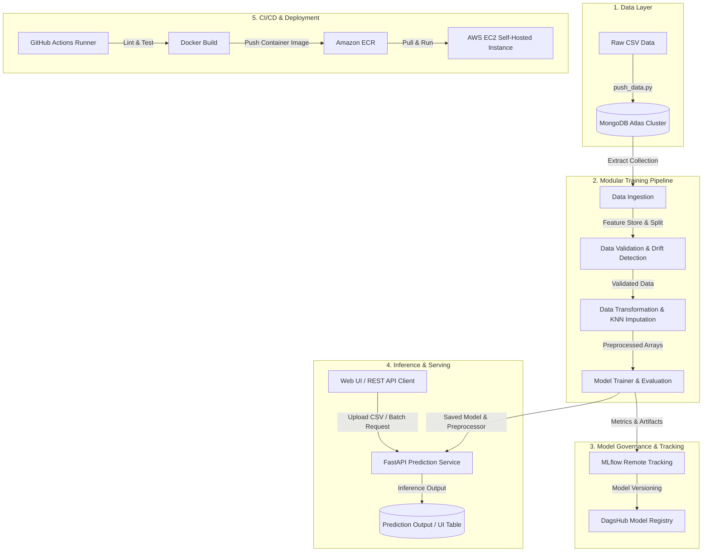

# 🛡️ PhishGuard: Production MLOps Network Security & Phishing Detection

[](https://www.python.org/)
[](https://fastapi.tiangolo.com/)
[](https://www.mongodb.com/)
[](https://mlflow.org/)
[](https://dagshub.com/)
[](https://www.docker.com/)
[](https://aws.amazon.com/)
[](https://github.com/features/actions)

An end-to-end, production-ready Machine Learning Operations (MLOps) platform that identifies phishing threats and malicious network traffic. The platform automates the complete machine learning lifecycle: cloud data extraction, schema validation, data drift detection, distributed model training, experiment logging with MLflow on DagsHub, and automated CI/CD deployment via Docker and AWS ECR/EC2.

---

## 📑 Table of Contents
- [Project Overview](#-project-overview)
- [System Architecture](#-system-architecture)
- [Key Features](#-key-features)
- [Tech Stack](#-tech-stack)
- [Project Directory Structure](#-project-directory-structure)
- [Getting Started](#-getting-started)
  - [Prerequisites](#prerequisites)
  - [Installation & Virtual Environment](#installation--virtual-environment)
  - [Environment Variables Configuration](#environment-variables-configuration)
- [Running the Pipelines](#-running-the-pipelines)
  - [1. Push Dataset to MongoDB Atlas](#1-push-dataset-to-mongodb-atlas)
  - [2. Execute Training Pipeline](#2-execute-training-pipeline)
  - [3. Run the FastAPI Application](#3-run-the-fastapi-application)
- [MLflow & DagsHub Tracking](#-mlflow--dagshub-tracking)
- [CI/CD & Cloud Deployment](#-cicd--cloud-deployment)
- [API Endpoints](#-api-endpoints)

---

## 📌 Project Overview

Phishing attacks and malicious network intrusions continue to evolve in sophistication. Traditional rule-based filters often fail to identify zero-day attacks and dynamic threat patterns. 

**PhishGuard** delivers a modular, resilient MLOps architecture that:
1. Extracts raw network features and traffic behavior from a secure remote **MongoDB Atlas** database.
2. Performs automated schema conformance checking and statistical data drift analysis.
3. Automatically trains and compares multiple classification models (Random Forest, Gradient Boosting, AdaBoost, Decision Trees, Logistic Regression) using cross-validation.
4. Registers and versions high-performing models to **DagsHub / MLflow**.
5. Exposes batch prediction APIs with a **FastAPI** web interface.
6. Automates testing, container packaging, and production rollout using **GitHub Actions CI/CD** targeting **Amazon ECR** and **AWS EC2**.

---

## 🏗️ System Architecture



---

## ✨ Key Features

- **Decoupled Architecture**: Clean object-oriented components for data ingestion, validation, transformation, and model training.
- **Statistical Data Drift Detection**: Generates automated drift reports comparing training and validation distributions using Kolmogorov-Smirnov statistical tests.
- **Robust Preprocessing Pipeline**: Handles missing values dynamically using K-Nearest Neighbors (`KNNImputer`) and serializes preprocessors alongside models.
- **Centralized Experiment Tracking**: Synchronizes runs, parameters, metrics (F1 Score, Precision, Recall), and model artifacts with DagsHub-hosted MLflow.
- **RESTful Prediction API**: High-performance FastAPI endpoints supporting interactive Swagger documentation and batch CSV inference.
- **Production CI/CD Automation**: Fully configured GitHub Actions workflows for building Docker images, publishing to Amazon ECR, and continuous deployment to AWS EC2 self-hosted runners.

---

## 🛠️ Tech Stack

| Domain | Technology / Tool | Purpose |
|---|---|---|
| **Language** | Python 3.11 | Core development |
| **Database** | MongoDB Atlas (Cloud) | Scalable NoSQL raw network data repository |
| **ML Frameworks** | Scikit-Learn, NumPy, Pandas | Model building, evaluation, and numerical computation |
| **Pipeline Tracking** | MLflow, DagsHub | Experiment tracking, hyperparameter logging, model registry |
| **API Framework** | FastAPI, Uvicorn, Jinja2 | Async web server, prediction endpoints, templated UI |
| **Containerization** | Docker | Environment packaging and repeatable deployments |
| **Cloud Services** | AWS ECR & EC2 | Container registry and production compute |
| **CI/CD** | GitHub Actions | Automated build, test, and continuous delivery pipeline |

---

## 📂 Project Directory Structure

```text
MLOPS-Network_security/
│
├── .github/
│   └── workflows/
│       └── main.yml                   # GitHub Actions CI/CD workflow
│
├── data_schema/
│   └── schema.yaml                    # Dataset schema definitions & target mapping
│
├── final_model/
│   ├── model.pkl                      # Serialized production classifier
│   └── preprocessor.pkl               # Data transformation & imputation pipeline
│
├── Network_Data/
│   └── phisingData.csv                # Raw phishing features benchmark dataset
│
├── networksecurity/                   # Core modular package
│   ├── cloud/
│   │   └── s3_syncer.py               # AWS S3 synchronization utilities
│   ├── components/
│   │   ├── data_ingestion.py          # MongoDB extraction & feature store splitting
│   │   ├── data_validation.py         # Schema checking & data drift analysis
│   │   ├── data_transformation.py     # KNN imputation & array conversion
│   │   └── model_trainer.py           # Multi-model evaluation & MLflow logging
│   ├── constant/
│   │   └── training_pipeline/         # Global configuration constants
│   ├── entity/
│   │   ├── config_entity.py           # Ingestion, validation, transformation configs
│   │   └── artifact_entity.py         # Output artifacts per pipeline stage
│   ├── exception/
│   │   └── exception.py               # Custom detailed exception handler
│   ├── logging/
│   │   └── logger.py                  # Standardized timestamped logging
│   ├── pipeline/
│   │   ├── training_pipeline.py       # Orchestrator for all pipeline components
│   │   └── batch_prediction.py        # Batch prediction orchestrator
│   └── utils/
│       ├── main_utils/utils.py        # YAML, pickle, and numpy array utilities
│       └── ml_utils/                  # Metric computation & estimator wrappers
│
├── templates/
│   └── table.html                     # Frontend interface for batch predictions
│
├── .env.example                       # Environment variables template
├── .gitignore                         # Git-ignored directories and sensitive files
├── app.py                             # FastAPI server & prediction endpoints
├── Dockerfile                         # Container build instructions
├── main.py                            # CLI entrypoint to run training pipeline
├── push_data.py                       # Helper script to load local data to MongoDB
├── requirements.txt                   # Production Python dependencies
├── setup.py                           # Package setup for editable installation
└── test_mongodb.py                    # Cluster connectivity verification script
```

---

## 🚀 Getting Started

### Prerequisites
- **Python 3.10 or 3.11** installed
- A **MongoDB Atlas** account and cluster
- A **DagsHub** account (for MLflow remote experiment tracking)
- *(Optional for cloud deployment)*: **AWS Account** with IAM user and ECR repository

---

### Installation & Virtual Environment

1. **Clone the repository:**
   ```bash
   git clone https://github.com/<YOUR_USERNAME>/<YOUR_REPOSITORY_NAME>.git
   cd MLOPS-Network_security
   ```

2. **Create and activate a virtual environment:**
   - **Windows (PowerShell):**
     ```powershell
     python -m venv venv
     .\venv\Scripts\Activate.ps1
     ```
   - **Linux / macOS:**
     ```bash
     python3 -m venv venv
     source venv/bin/activate
     ```

3. **Install dependencies and editable package:**
   ```bash
   pip install -r requirements.txt
   pip install -e .
   ```

---

### Environment Variables Configuration

Copy `.env.example` to `.env`:
```bash
cp .env.example .env
```

Open `.env` and configure your credentials:

```env
# ==========================================
# MongoDB Atlas Configuration
# ==========================================
MONGO_DB_URL=mongodb+srv://<username>:<password>@cluster0.abcde.mongodb.net/?retryWrites=true&w=majority
MONGODB_URL_KEY=mongodb+srv://<username>:<password>@cluster0.abcde.mongodb.net/?retryWrites=true&w=majority

MONGO_DATABASE_NAME=KRISHAI
MONGO_COLLECTION_NAME=NetworkData

# ==========================================
# MLflow & DagsHub Configuration
# ==========================================
MLFLOW_TRACKING_URI=https://dagshub.com/<username>/<repo_name>.mlflow
MLFLOW_TRACKING_USERNAME=<your_dagshub_username>
MLFLOW_TRACKING_PASSWORD=<your_dagshub_token>

DAGSHUB_REPO_OWNER=<your_dagshub_username>
DAGSHUB_REPO_NAME=<your_repo_name>

# ==========================================
# AWS Deployment Secrets (For GitHub Actions & ECR)
# ==========================================
AWS_ACCESS_KEY_ID=
AWS_SECRET_ACCESS_KEY=
AWS_REGION=us-east-1
AWS_ECR_LOGIN_URI=
ECR_REPOSITORY_NAME=networkssecurity
```

Verify your MongoDB cluster connection:
```bash
python test_mongodb.py
```
*Output: `Pinged your deployment. You successfully connected to MongoDB!`*

---

## 🔄 Running the Pipelines

### 1. Push Dataset to MongoDB Atlas
Upload the local raw phishing features from `Network_Data/phisingData.csv` into your MongoDB collection:
```bash
python push_data.py
```

### 2. Execute Training Pipeline
Run the end-to-end training pipeline locally:
```bash
python main.py
```
This performs:
- Ingestion from MongoDB -> Train/Test split (80/20).
- Schema validation & data drift report generation in `Artifacts/<timestamp>/data_validation/`.
- Data transformation & KNN Imputation.
- Multi-model evaluation (Random Forest, Decision Tree, Gradient Boosting, Logistic Regression, AdaBoost).
- Selection of the best performing model based on F1 Score and registration with MLflow.

### 3. Run the FastAPI Application
Start the production web server:
```bash
python app.py
```
- Open your browser at: **`http://localhost:8080`**
- Interactive Swagger API docs: **`http://localhost:8080/docs`**

---

## 📊 MLflow & DagsHub Tracking

Every execution of `main.py` automatically registers experiment runs with your DagsHub remote tracking URI:
- **Logged Parameters**: Imputer parameters, classifier hyperparameter grids.
- **Logged Metrics**: Precision, Recall, and F1 Score for train and test splits.
- **Logged Artifacts**: Serialized model object (`model.pkl`) and preprocessing pipeline.

To view your experiment dashboard, open:
`https://dagshub.com/<your_username>/<your_repo>` -> Click **MLflow Tracking**.

---

## ☁️ CI/CD & Cloud Deployment

The repository includes a GitHub Actions workflow in [`.github/workflows/main.yml`](.github/workflows/main.yml) that automates delivery on every push to `main`:

1. **Continuous Integration**: Code checkout and unit tests.
2. **Continuous Delivery**: Builds Docker image and pushes it to Amazon ECR.
3. **Continuous Deployment**: Triggers a self-hosted runner on AWS EC2, pulls the latest Docker image, and runs the container on port `8080`.

### Setting up GitHub Secrets:
Add the following secrets under **Repository -> Settings -> Secrets and variables -> Actions**:
- `AWS_ACCESS_KEY_ID`
- `AWS_SECRET_ACCESS_KEY`
- `AWS_REGION`
- `AWS_ECR_LOGIN_URI`
- `ECR_REPOSITORY_NAME`

---

## 🔌 API Endpoints

| Method | Endpoint | Description |
|---|---|---|
| `GET` | `/` | Web interface redirecting to interactive documentation |
| `GET` | `/docs` | OpenAPI / Swagger interactive documentation |
| `GET` | `/train` | Triggers the complete training pipeline programmatically |
| `POST` | `/predict` | Upload a CSV file to generate batch phishing threat predictions |

---

## 📜 License
This project is licensed under the MIT License.
